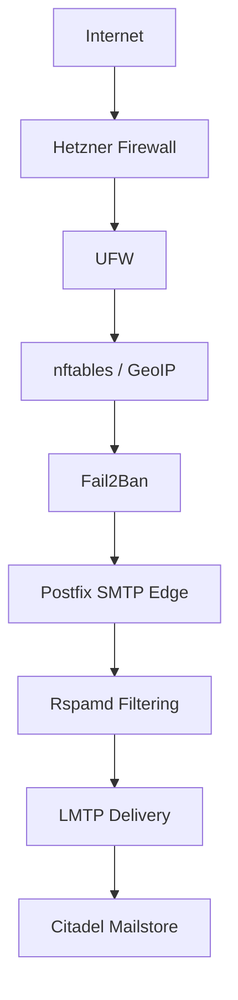
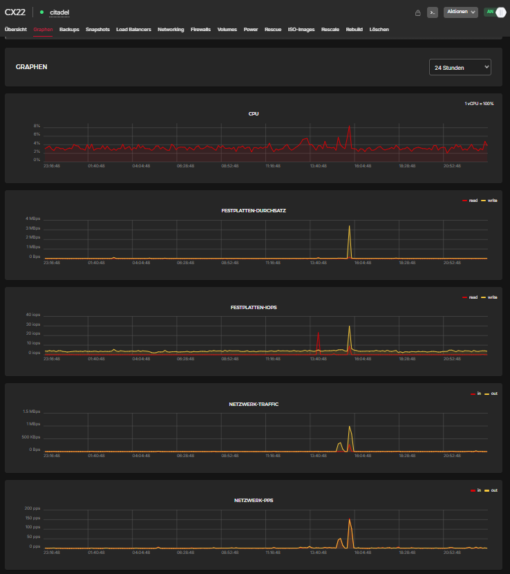
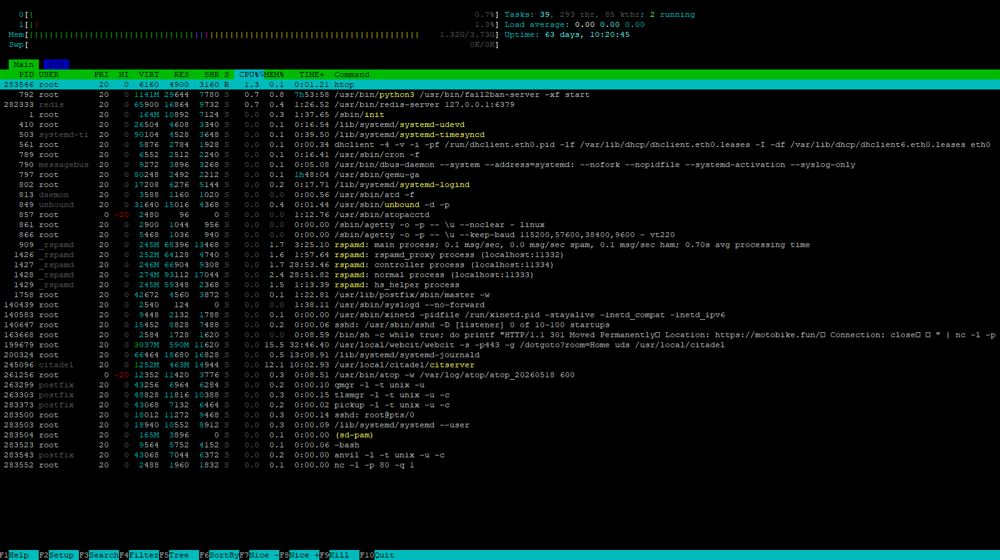

# Modern Citadel Mail Platform

Modern Citadel Mail Platform is a native Linux mail and collaboration stack based on Citadel Groupware, Postfix, LMTP and Rspamd.

This project demonstrates that modern, secure and scalable communication infrastructure can still be built using transparent Unix principles without container orchestration or cloud dependency.

---

# Philosophy

This project follows several core principles:

- native Linux services
- transparent architecture
- no Docker or Kubernetes
- low operational complexity
- modular mail flow
- efficient resource usage
- complete infrastructure ownership
- long-term maintainability

The goal is not nostalgia.

The goal is proving that classic Unix architecture can still provide modern and secure communication infrastructure.

---

# Core Technologies

## Mail Platform

- Citadel Groupware
- Postfix SMTP Edge
- LMTP local delivery
- Rspamd spam filtering
- DKIM / DMARC / ARC
- MTA-STS

## Security

- nftables
- iptables
- UFW
- Fail2Ban
- WireGuard administration VPN

## Infrastructure

- native Debian Linux
- Hetzner CX22
- no containers
- no orchestration
- low resource footprint

---

# Architecture Overview

---

# Mail Flow

Incoming mail follows this path:

Internet → Postfix (port 25) → Rspamd milter → unfiltered LMTP → Citadel

Postfix checks recipients against Citadel during the SMTP dialogue. Unknown addresses on motobike.fun, g00r00.com and vibedullis.com are refused with `550 5.1.1`, so those messages never become backscatter.

Outgoing mail follows this path:

Mail client → Citadel submission → Citadel DKIM → Postfix `127.0.0.1:10025` → Rspamd ARC → Internet

Citadel signs outbound mail with DKIM selector `dvbbt`. Rspamd ARC-signs that relay with selector `arc2026` and leaves DKIM signing disabled.

This architecture separates:

- SMTP transport
- spam filtering
- queue management
- local delivery
- mailbox storage

into dedicated Unix services.

---

# Reputation Management

The platform integrates modern reputation-aware mail handling using:

- Rspamd
- Redis
- Microsoft SNDS
- Microsoft JMRP
- ARF complaint processing
- custom Lua extensions

The goal is not only spam filtering but continuous reputation monitoring and adaptive filtering behavior.

This allows integration of:

- complaint feedback loops
- sender reputation telemetry
- adaptive filtering
- abuse-aware automation
- provider-specific deliverability monitoring

For additional details see:

[Reputation Management Documentation](docs/reputation-management.md)

---

# Infrastructure

The current production system runs on:

- Hetzner CX22
- 2 vCPU
- 4 GB RAM
- 40 GB SSD

while maintaining very low CPU and memory utilization.

## Infrastructure Overview

## Production htop Snapshot

---

# Security Model

The platform uses layered security:

- provider firewall
- host firewall
- GeoIP filtering
- Fail2Ban jail segmentation
- WireGuard administration access
- SMTP relay restrictions
- modern TLS configuration
- DKIM / SPF / DMARC validation

---

# Why Native Linux?

This project intentionally avoids:

- Docker
- Kubernetes
- large orchestration frameworks
- opaque infrastructure abstraction

Advantages:

- lower RAM usage
- lower storage overhead
- transparent troubleshooting
- direct service visibility
- simpler maintenance
- educational value
- long-term reliability

---

# Platform Components

| Component | Purpose |
|---|---|
| Citadel Groupware | Mailstore, submission, DKIM signing and groupware |
| Postfix | SMTP edge, outbound relay, recipient verification and queues |
| LMTP | Local delivery into Citadel through the unfiltered LMTP socket |
| Rspamd | Spam filtering, ARC signing, policy enforcement and ARF suppression |
| Redis | Bayesian statistics and the ARF suppression list |
| Fail2Ban | Bans for SSH, Postfix and Citadel authentication |
| Certbot | Let's Encrypt certificates for Citadel, WebCit and Postfix |
| nftables | Packet filtering and traffic control |
| UFW | Host-level firewall management |
| Hetzner Firewall | Upstream infrastructure firewall |
| WireGuard | Secure administrative VPN access |
| WebCit | Webmail and groupware frontend (`webcit-http`, `webcit-https`) |
| MTA-STS | Enforced TLS policy for motobike.fun |
| Postfix Queue | Reliable deferred mail handling |

---

# Documentation

## Core Documentation

- [Design Philosophy](docs/design-philosophy.md)
- [Mail Flow](docs/mail-flow.md)
- [Infrastructure](docs/infrastructure.md)
- [Performance](docs/performance.md)
- [Native Linux Deployment](docs/native-linux-deployment.md)

## Security Documentation

- [Security Model](docs/security-model.md)
- [Security Stack](docs/security-stack.md)
- [Rspamd Integration](docs/rspamd-integration.md)
- [WKD Integration](docs/wkd-integration.md)

## Mail Architecture

- [Postfix LMTP Migration](docs/postfix-lmtp-migration.md)
- [Mail Queue Philosophy](docs/mail-queue-philosophy.md)

## Citadel Modernization

- [Citadel Modernization](docs/citadel-modernization.md)

## Technical Diagrams

- [Full Mail Stack](diagrams/full-mail-stack.md)
- [Platform Architecture](diagrams/platform-architecture.md)

---

# Production Goals

The project demonstrates:

- modern mail security
- efficient native infrastructure
- low-resource production hosting
- transparent Unix service architecture
- container-free deployment
- self-hosted communication sovereignty

---

# Status

Production system running stable.

Features currently deployed:

- LMTP delivery
- Rspamd filtering
- recipient verification
- Citadel DKIM signing (`dvbbt`)
- Rspamd ARC signing (`arc2026`)
- DMARC `p=reject` / `sp=reject`
- MTA-STS enforce
- ARF recipient suppression
- case-sensitive mailbox passwords
- WireGuard administration
- GeoIP filtering
- multi-domain hosting
- queue-based reliability
- daily Hetzner backups
- Fail2Ban `citadel-auth` jail
- Let's Encrypt certificates with automatic renewal

---

# License

MIT License
