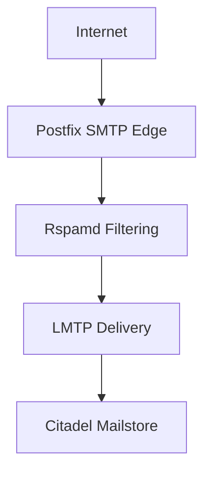
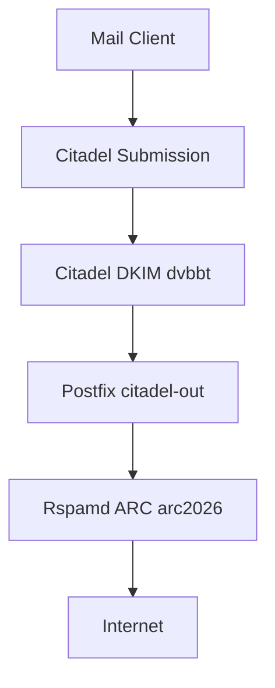

# Mail Flow

## Overview

The Modern Citadel Mail Platform uses a modular Unix-style mail architecture with clear separation of responsibilities.

Instead of combining all functionality into a monolithic application, the platform separates:

- SMTP transport
- spam filtering
- queue management
- local delivery
- mailbox storage

into specialized native Linux services.

This improves:

- maintainability
- transparency
- troubleshooting
- modularity
- operational reliability

---

# Inbound Mail Flow

Incoming mail follows this path:



---

## Postfix SMTP Edge

Postfix acts as the public SMTP entry point on port 25.

Responsibilities:

- inbound SMTP handling
- TLS encryption
- queue management
- retry handling
- relay restrictions
- protocol validation
- recipient verification
- message size limits

Postfix intentionally operates as the external mail transport layer while Citadel focuses on mailbox and groupware functionality.

Since 2026-10-18, Postfix verifies recipients against Citadel during the SMTP dialogue (`reject_unverified_recipient`). Unknown recipients are refused with `550 5.1.1` before the message is accepted. This covers motobike.fun, g00r00.com and vibedullis.com, so unknown addresses on those domains do not generate backscatter.

`message_size_limit` is 50 MB (`52428800`), the same limit Citadel uses. The limit applies to inbound port 25 and to the outbound relay listener.

Mail to `root@` is aliased through `virtual_alias_maps` to the postmaster/admin mailbox.

---

## Rspamd Filtering

Rspamd is integrated using Postfix milters.

Responsibilities:

- spam detection
- DKIM verification
- DMARC evaluation
- DNSBL checks
- reputation analysis
- policy enforcement
- `Authentication-Results` headers (`milter_headers`)

Rspamd 3.4 listens as a milter on `localhost:11332` and processes mail before final local delivery.

DKIM signing of outbound mail is done by Citadel. Rspamd DKIM signing is disabled.

---

## LMTP Delivery

After filtering, Postfix delivers mail to Citadel using LMTP.


LMTP replaces the older SMTP-based local delivery previously used between Postfix and Citadel.

Postfix delivers accepted mail to Citadel's unfiltered LMTP socket:

```text
/usr/local/citadel/lmtp-unfiltered.socket
```

The unfiltered socket is used because spam filtering already happened in the Rspamd milter.

Advantages of LMTP:

- direct mailbox delivery
- cleaner local architecture
- reduced internal SMTP complexity
- proper local delivery semantics
- improved service separation

Citadel provides native LMTP sockets for local message injection.

---

## Citadel Mailstore

Citadel handles:

- mailbox storage
- IMAP access on port 993
- client submission on ports 587 and 465
- outbound DKIM signing (selector `dvbbt`)
- webmail
- groupware functionality
- collaboration features
- message indexing

Citadel acts as the final message destination within the platform.

---

# Outbound Mail Flow

A mail client submits to Citadel, Citadel DKIM-signs the message, and Citadel's smarthost hands it to a localhost-only Postfix listener. Postfix then delivers to the Internet.



## Citadel Submission

Citadel accepts client submission on:

- port 587 with STARTTLS
- port 465 with implicit TLS

IMAPS is on port 993. WebCit is on ports 80 and 443 as the separate services `webcit-http` and `webcit-https`.

Citadel DKIM-signs outbound mail with selector `dvbbt` for motobike.fun, g00r00.com and vibedullis.com.

Since 2026-10-18, Citadel compares passwords case-sensitively (`c_case_sensitive_passwords=1`).

## Local Postfix Relay

Citadel's smarthost is Postfix on `127.0.0.1:10025`. The syslog name of that listener is `postfix/citadel-out`.

The listener:

- accepts only from `127.0.0.0/8` (`permit_mynetworks`, `reject`)
- does not use SASL
- does not use TLS on this local hop
- runs the Rspamd milter
- sets `receive_override_options=no_address_mappings`
- sets `milter_default_action=accept`
- uses the same 50 MB `message_size_limit` as inbound port 25

Postfix delivers the accepted mail to the Internet.

Rspamd on this relay ARC-signs the message. Rspamd DKIM signing is disabled (`dkim_signing` enabled = false), so the message keeps the Citadel signature. ARC uses domain motobike.fun and selector `arc2026` for all three domains. The settings rule `outbound_citadel` (127.0.0.1 and ::1) disables reject, add-header, rewrite-subject and greylist actions for this traffic. Delivery to an address on the ARF suppression list is refused.

---

# Security Integration

The mail flow integrates multiple security layers:

- TLSv1.3
- SPF
- DKIM
- DMARC
- ARC
- MTA-STS
- DNSSEC
- Fail2Ban
- GeoIP filtering
- WireGuard restricted administration

This allows the platform to remain lightweight while still supporting modern mail security standards.

---

# Design Philosophy

The platform intentionally follows classic Unix principles:

- small specialized services
- clear separation of responsibilities
- transparent infrastructure
- native Linux integration
- minimal abstraction layers

The goal is not maximum complexity.

The goal is reliability, maintainability and operational transparency.
