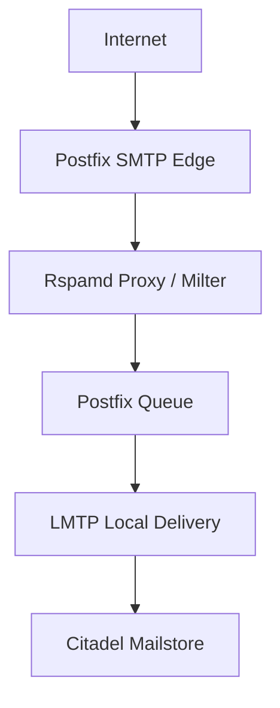

# Rspamd Integration

## Overview

This platform uses Rspamd 3.4 as the central mail filtering and policy engine.

Rspamd is deeply integrated into the mail flow and operates as a modern high-performance filtering layer between Postfix and Citadel LMTP delivery. The same milter also runs on the localhost outbound relay.

The integration provides:

- Spam filtering
- DKIM verification
- SPF validation
- DMARC enforcement
- ARC signing
- Bayesian learning
- Fuzzy hashing
- URL reputation checks
- MIME and attachment inspection
- Greylisting
- Rate limiting
- Reputation analysis
- DNSBL / SURBL checks
- Custom Lua-based extensions

The entire stack is deployed natively on Linux without containers.

---

# Architecture



Rspamd operates as a Milter-compatible filtering layer and analyzes messages before final LMTP delivery into Citadel.

This architecture separates:

- SMTP transport
- message filtering
- queue handling
- local mailbox delivery

into clearly isolated layers.

---

# Proxy Worker Integration

Rspamd is deployed using the proxy worker architecture.

```ucl
worker {
    rspamd_proxy {
        bind_socket = "localhost:11332";
        milter = true;
    }
}
```

The proxy worker integrates directly with Postfix using the Milter protocol on `localhost:11332`.

`milter_headers` adds `Authentication-Results` to processed mail.

Benefits:

- asynchronous filtering
- high throughput
- queue separation
- low latency
- scalable architecture

---

# Redis Backend

Redis is used for Bayesian statistics and for the ARF suppression list.

There is intentionally no global Redis block. Bayes has its own Redis settings, and the ARF module configures its Redis server in `modules.d/motobike_arf.conf`.

---

# Message Authentication

The platform implements modern mail authentication standards.

## SPF

SPF validation is enabled to verify sender authorization.

SPF authorizes `65.109.224.37`.

## DKIM

Rspamd verifies DKIM signatures.

Citadel DKIM-signs outbound mail with selector `dvbbt` for motobike.fun, g00r00.com and vibedullis.com. Rspamd DKIM signing is disabled, so relayed mail keeps the Citadel signature:

```ucl
dkim_signing {
    enabled = false;
}
```

## DMARC

DMARC policies are enforced to reduce spoofing and phishing attacks.

The hosted domains publish DMARC with `p=reject` and `sp=reject`.

## ARC

Rspamd ARC-signs outbound mail on the `postfix/citadel-out` relay.

ARC uses domain motobike.fun and selector `arc2026` for all three domains. The DNS TXT record is `arc2026._domainkey.motobike.fun`, published at GoDaddy.

```ucl
arc {
    domain = "motobike.fun";
    selector = "arc2026";
    use_domain_custom = "motobike.fun";
    sign_local = true;
    sign_inbound = false;
    sign_authenticated = false;
}
```

`sign_local` applies to 127.0.0.1 and ::1. `sign_inbound` and `sign_authenticated` are false.

The outbound listener sets `milter_default_action=accept`.

---

# Advanced Filtering

Rspamd is configured with extensive filtering capabilities.

## Reputation Systems

The platform uses:

- Spamhaus
- SURBL
- URIBL
- DNSWL
- Senderscore
- Spameatingmonkey

for sender and URL reputation analysis.

## Bayesian Learning

Bayesian filtering continuously improves spam detection quality.

## Fuzzy Hashing

Rspamd fuzzy hashing is part of the filtering pipeline.

## Outbound Relay Policy

The settings rule `outbound_citadel` matches 127.0.0.1 and ::1.

For that traffic it disables these actions:

- reject
- add-header
- rewrite-subject
- greylist

Outbound mail from Citadel is accepted under that rule. A recipient on the ARF suppression list is refused on `postfix/citadel-out`.

## Sender Blacklist

One multimap file lists blocked senders, one address or domain per line.

Four rules read that file. Each rule uses `action=reject`:

- envelope sender by domain
- envelope sender by full address
- `From:` header by domain
- `From:` header by full address

## Greylisting

Greylisting is enabled for unknown senders.

The `outbound_citadel` rule disables greylisting for 127.0.0.1 and ::1.

```ucl
greylist {
    action = "soft reject";
    timeout = 300;
}
```

## MIME and Attachment Inspection

Rspamd inspects:

- Office documents
- PDF files
- archive files
- MIME anomalies
- obfuscated attachments

to detect malicious content and phishing attempts.

---

# Custom Lua Extensions

The platform includes custom Lua-based Rspamd modules.

## motobike_arf

`motobike_arf.lua` is loaded from `rspamd.local.lua`. Its Redis server is configured in `modules.d/motobike_arf.conf`.

```ucl
motobike_arf {
    enabled = true;
}
```

Incoming ARF complaint reports (`multipart/report`, `message/feedback-report`) create a Redis key `suppression:<address>` for 180 days. The address is taken from the `Original-Rcpt-To` field.

Outbound mail through the `postfix/citadel-out` relay to a suppressed address is rejected with:

```text
554 5.7.1 Recipient suppressed (ARF complaint)
```

This has been in production since 2026-10-18.

Microsoft SNDS and JMRP are set up for the server IP.

---

# Administrative Security

Rspamd administrative interfaces are not publicly exposed.

The controller worker is bound only to localhost.

```ucl
bind_socket = "localhost:11334";
secure_ip = "127.0.0.1";
```

Administrative access is available only through:

- SSH
- WireGuard VPN

This reduces the attack surface significantly.

---

# Native Linux Deployment Philosophy

The entire platform is deployed natively on Linux without Docker or container orchestration.

Benefits include:

- lower resource consumption
- direct system visibility
- simplified troubleshooting
- reduced abstraction layers
- improved long-term maintainability
- deeper understanding of system internals

This design follows classic Unix principles:

- modularity
- transparency
- service separation
- local socket communication
- minimal overhead

---

# Conclusion

Rspamd forms the central security and filtering component of the Modern Citadel Mail Platform.

Combined with:

- Postfix
- LMTP
- Citadel
- Redis
- WireGuard
- Fail2Ban
- nftables

the result is a lightweight but highly capable native Linux mail platform focused on:

- security
- transparency
- efficiency
- maintainability
- independence from cloud ecosystems
- deep system integration
