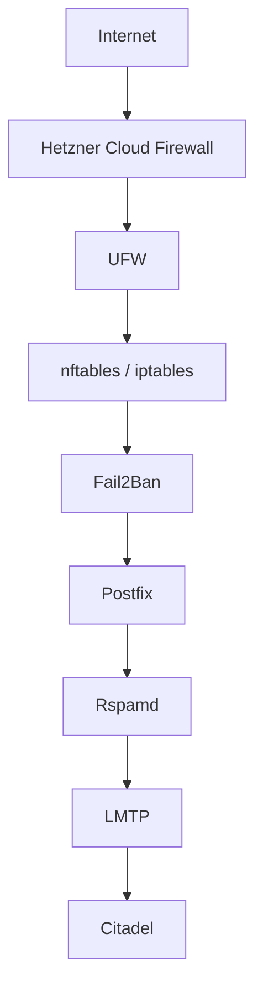

# Security Stack

## Overview

The Modern Citadel Mail Platform uses a layered Unix-style security architecture.

Instead of relying on a single monolithic security appliance, the platform combines multiple independent security layers:

- Hetzner Cloud Firewall
- UFW
- nftables
- Fail2Ban
- WireGuard
- Postfix hardening
- Rspamd filtering
- TLS encryption
- DNS-based authentication technologies

This creates a defense-in-depth architecture with clear separation of responsibilities.

---

# Security Architecture



---

# Hetzner Cloud Firewall

The first external security layer is provided by the Hetzner Cloud Firewall.

Only required public services are exposed:

| Port | Service |
|---|---|
| 25 | SMTP (Postfix) |
| 80 | HTTP (WebCit `webcit-http` / ACME) |
| 443 | HTTPS (WebCit `webcit-https`) |
| 465 | Implicit TLS submission (Citadel) |
| 587 | STARTTLS submission (Citadel) |
| 993 | IMAPS (Citadel) |
| 51820/UDP | WireGuard |

All other traffic is blocked at the infrastructure edge.

IPv4 and IPv6 filtering are both enabled.

---

# UFW

UFW provides host-level firewall management.

The UFW configuration mirrors the externally exposed Hetzner firewall ports while allowing local service communication internally.

Responsibilities:

- host-level access control
- local service filtering
- interface separation
- additional protection layer after Hetzner edge filtering

---

# nftables / iptables

The platform uses nftables with iptables-nft compatibility.

nftables handles:

- packet filtering
- Fail2Ban integration
- permanent blocklists
- VPN forwarding
- connection filtering

The ruleset is intentionally kept transparent and maintainable.

---

# Fail2Ban

Fail2Ban provides automatic intrusion response and abuse mitigation.

Active jails:

- sshd
- postfix-smtp
- postfix-msasubmission
- citadel-auth
- perma-ban

Citadel logs to the systemd journal. The `citadel-auth` jail uses the systemd backend and reads `citserver` messages with `SYSLOG_IDENTIFIER=citserver`. `journalflags=1` is set because `citserver` runs as the `citadel` user. The jail needs the Debian package `python3-systemd`.

The jail matches Citadel's failed-password message, for IPv4 and IPv6:

```text
CtdlTryPassword: bad password specified for <user> ... Remote <host / IP>
```

Five failures in 10 minutes produce a ban of 1 hour on ports 80, 443, 465, 587 and 993. The jail counts failed passwords. A connection by itself does not create a ban. Localhost and the admin VPN are ignored.

The earlier Citadel jails `citadel-msasubmission`, `smtp-citadel`, `smtp-submission` and `webcit` are retired.

This protects against:

- SMTP abuse
- brute-force attacks
- credential guessing
- web interface abuse
- automated scanners

---

# Permanent Ban Lists

The platform additionally maintains permanent blocklists for known abusive systems.

This reduces repeated attack traffic and lowers unnecessary processing load.

---

# WireGuard Administrative Isolation

Administrative access is isolated through WireGuard VPN.


WireGuard network:

```text
10.*.*.*/24
```

Administrative services are intentionally not publicly exposed.

Examples:

- Rspamd WebUI
- internal management interfaces
- local service administration
- SSH management workflows

This significantly reduces exposed attack surface.

---

# Postfix Hardening

Postfix acts as the public SMTP edge service.

Security features include:

- relay restrictions
- recipient verification
- sender validation
- SMTP rate limiting
- queue separation
- TLS on the public SMTP listener
- a localhost-only outbound relay

Postfix listens on port 25, runs the Rspamd milter, and delivers accepted mail to Citadel over the unfiltered LMTP socket.

Since 2026-10-18, unknown recipients are rejected during the SMTP dialogue with `reject_unverified_recipient`. The response is `550 5.1.1` for unknown addresses on motobike.fun, g00r00.com and vibedullis.com.

`message_size_limit` is 50 MB (`52428800`) on port 25 and on the outbound relay, matching Citadel.

Mail to `root@` is aliased with `virtual_alias_maps` to the postmaster/admin mailbox.

Client submission is handled by Citadel on 587 and 465. Outbound mail from Citadel goes to Postfix on `127.0.0.1:10025` (`postfix/citadel-out`). That listener accepts only `127.0.0.0/8` (`permit_mynetworks`, `reject`), uses no SASL and no TLS on the local hop, runs the Rspamd milter, and sets `receive_override_options=no_address_mappings` and `milter_default_action=accept`. Postfix then delivers to the Internet.

Postfix is intentionally separated from mailbox handling responsibilities.

---

# LMTP Local Delivery

Internal mail delivery uses the unfiltered LMTP socket:

```text
/usr/local/citadel/lmtp-unfiltered.socket
```


Advantages:

- local-only delivery
- reduced internal SMTP exposure
- cleaner service separation
- direct mailbox delivery semantics

The previous internal SMTP transport on port 2025 is no longer required for local delivery operations.

---

# Rspamd Security Layer

Rspamd provides advanced mail filtering and message authentication.

Features include:

- DKIM verification
- ARC signing on the outbound relay
- spam scoring
- DNSBL checks
- reputation analysis
- policy enforcement
- a sender blacklist
- ARF recipient suppression
- Redis for Bayes and that suppression list
- Lua scripting support

Rspamd 3.4 is integrated using the Postfix milter on `localhost:11332`. `milter_headers` adds `Authentication-Results`.

Citadel DKIM-signs outbound mail with selector `dvbbt`. Rspamd `dkim_signing` is disabled. ARC uses selector `arc2026` and domain motobike.fun for motobike.fun, g00r00.com and vibedullis.com. The TXT record `arc2026._domainkey.motobike.fun` is published at GoDaddy.

The settings rule `outbound_citadel` matches 127.0.0.1 and ::1 and disables reject, add-header, rewrite-subject and greylist for that relay. A suppressed recipient is refused with `554 5.7.1 Recipient suppressed (ARF complaint)`.

---

# Modern Mail Security Standards

The platform supports modern email security technologies:

- SPF
- DKIM
- DMARC (`p=reject`, `sp=reject`)
- ARC
- MTA-STS
- DNSSEC
- TLSv1.2
- TLSv1.3

MTA-STS is served by WebCit in enforce mode (`mx` motobike.fun, `max_age` 86400) from `/usr/local/webcit/static/.well-known/mta-sts.txt`:

```text
https://mta-sts.motobike.fun/.well-known/mta-sts.txt
```

SPF authorizes `65.109.224.37`. Gmail validation on 2026-10-18 showed `dkim=pass` (`dvbbt`), `spf=pass`, `dmarc=pass`, `arc=pass` and TLS 1.3. Microsoft/Outlook showed SPF, DKIM and DMARC pass.

This improves:

- sender authenticity
- transport security
- anti-spoofing protection
- SMTP trust validation

---

# Let's Encrypt

Certificates come from Let's Encrypt through certbot, using the webroot authenticator.

The webroot is `/usr/local/webcit/static`. WebCit serves `/.well-known/acme-challenge` on port 80, so issuance and renewal run while the services stay up.

`certbot.timer` renews certificates automatically.

The Citadel and WebCit certificate is used on ports 443, 465, 587 and 993. It covers:

- motobike.fun
- mail.motobike.fun
- smtp.motobike.fun
- mta-sts.motobike.fun
- xmpp.motobike.fun
- mail.g00r00.com
- mail.vibedullis.com

`/usr/local/citadel/keys/citadel.cer` and `citadel.key` are symlinks into `/etc/letsencrypt/live/`.

Postfix on port 25 uses its own Let's Encrypt certificate.

Renewal hooks:

- a pre hook makes sure the webroot `.well-known` directory exists
- a deploy hook checks the Citadel key symlinks and restarts `citadel`, `webcit-http` and `webcit-https`
- that deploy hook reloads Postfix when the Postfix certificate renews

---

# Unix Security Philosophy

The security architecture intentionally follows classic Unix principles:

- multiple small security layers
- minimal public exposure
- local-only administrative services
- native Linux integration
- transparent configurations
- operational simplicity

The goal is not complexity.

The goal is visibility, maintainability and reliable long-term operation.

---

# Operational Philosophy

The platform avoids dependency on:

- Docker
- Kubernetes
- external SaaS platforms
- proprietary mail appliances
- hosted groupware ecosystems

Instead, the system focuses on:

- native Linux services
- transparent administration
- local data ownership
- hardware efficiency
- long-term maintainability
- educational value through direct system understanding

This allows the platform to run efficiently even on small systems such as:

- Raspberry Pi
- low-power x86 servers
- RISC-V systems
- lightweight virtual machines

while still supporting modern mail security standards.
